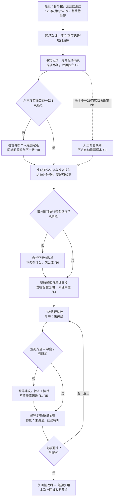

# 仓库 8 份文件 · 评审与落地清单

本文件汇总仓库中 8 个源文件的评审结论、建议文案与落地行动项。对应一个 Issue 和一个 PR。

## 文件索引

1. `README.md`
2. `提示词.md`
3. `禾里连锁巡店整改_现状流程图.png`
4. `连锁巡店与运营改进-业务挖掘报告.md`
5. `连锁巡店与运营改进-现场调研报告.md`
6. `连锁巡店与运营改进-方案设计报告.md`
7. `连锁巡店与运营改进-方案设计报告.docx`
8. `连锁巡店与运营改进技术方案-源码.md`

---

## 1. `README.md`

# README 评审与落地清单

## 1. 结论

当前 README 只有标题，不足以说明项目是什么、处于什么阶段、文件之间是什么关系。建议按下列结构重写，并把边界声明前置。

## 2. 建议文案骨架

```markdown
# Chain-Store-Inspection-and-Opentional-Improvement

> 连锁巡店评分口径统一与整改闭环的业务智能体练习项目。
> 仓库名保留历史拼写 `Opentional`（应为 Operational），为避免破坏既有链接暂不改名。

## 项目状态

- 阶段一源码归档完成（FastAPI + RBAC + FA4 + RAG + Hermes）。
- 业务挖掘 / 现场调研 / 方案设计报告状态：未确认。
- 本项目为合成训练与项目练习产物，不代表真实授权、业务执行或客户验收。

## 文件导航

| 文件 | 用途 | 建议阅读顺序 |
| --- | --- | --- |
| README.md | 仓库说明与导航 | 1 |
| 提示词.md | 技术约定与 PRD 基线 | 2 |
| 连锁巡店与运营改进-业务挖掘报告.md | 机会识别、基线、立项 | 3 |
| 连锁巡店与运营改进-现场调研报告.md | 访谈、现状流程、四来源收敛 | 4 |
| 连锁巡店与运营改进技术方案-源码.md | 阶段一 30 个 Python 文件归档 | 5 |
| 连锁巡店与运营改进-方案设计报告.md | 试点、边界、报价 ROI | 6 |
| 连锁巡店与运营改进-方案设计报告.docx | 上一条的只读导出件 | 7 |
| 禾里连锁巡店整改_现状流程图.png | as-is 流程图 | 8 |

## 快速开始

见 `docs/技术源码-评审与落地清单.md` 中的启动与自测章节。

## 证据编号

报告中的 `food-franchise-f00` 至 `f33` 为访谈证据编号；跨报告引用请保留编号，不要改写为“某某说”。
```

## 3. 落地行动项

- [ ] 用上述骨架替换当前 README。
- [ ] 在 GitHub About 填入一句话描述与 `documentation`、`fastapi`、`rag` 等 topics。
- [ ] 在文件导航中链接 8 份评审清单（本 PR 系列）。
- [ ] 统一声明“合成训练”边界，避免被误认为生产系统。
- [ ] 决定是否修正仓库名拼写；若不改名，保留说明。

## 4. 验收

- README 在 5 分钟阅读内可定位任意文件。
- 所有链接指向仓库内真实文件。
- 边界声明出现在首屏。

---

## 2. `提示词.md`

# 提示词基线评审与落地清单

## 1. 路径替换表

| 原文位置 | 当前内容 | 建议改为 |
| --- | --- | --- |
| 第二节表格 | `C:/Users/qcycl/Desktop/连锁巡店与运营改进-现场调研报告.md` | `./连锁巡店与运营改进-现场调研报告.md` |
| 第二节表格 | `C:/Users/qcycl/Desktop/连锁巡店与运营改进-业务挖掘报告.md` | `./连锁巡店与运营改进-业务挖掘报告.md` |
| 第二节表格 | `C:/Users/qcycl/Desktop/利益相关者资料与分工.html` | `docs/利益相关者资料与分工.html`（尚未入库，标注待补） |
| 第二节表格 | `C:/Users/qcycl/Desktop/客户简报.html` | `docs/客户简报.html`（尚未入库，标注待补） |
| 第二节表格 | `C:/Users/qcycl/Desktop/业务发现访谈问题库.html` | `docs/业务发现访谈问题库.html`（尚未入库，标注待补） |
| 第二节表格 | `C:/Users/qcycl/Desktop/现状信息请求表.html` | `docs/现状信息请求表.html`（尚未入库，标注待补） |

## 2. 交付物引用修正

- 原文第 108 行：`连锁巡店智能体系统-设计方案.docx` → 实际存在的是 `连锁巡店与运营改进-方案设计报告.docx`。
- 原文第 108 行：`源码归档.md` → 实际存在的是 `连锁巡店与运营改进技术方案-源码.md`。
- 若确需保留旧名称，应新增别名说明，而不是让引用指向不存在的文件。

## 3. 约束澄清建议

| 主题 | 当前表述 | 建议表述 |
| --- | --- | --- |
| 技术栈 | “不可替换，不得自行替换框架” | “阶段一实现约束；试点验证阶段允许先用 RAG/规则，模型仅在非结构化评语归一化环节引入” |
| 注释规范 | “每行代码必须加注释” | “函数必须有中文 docstring；安全/权限/人工确认等关键逻辑必须有中文行内注释” |
| 证据状态 | 未声明 | “引用事实时必须标注：已访谈确认 / 标准参考答案 / 待核实假设” |
| 配置 | 只提 `config.yaml` | 补 `config.example.yaml` 与环境变量 `INSPECT_CONFIG`、`INSPECT_JWT_SECRET` |

## 4. 阶段一交付验收清单

- [ ] 变更文件清单（30 个 Python 文件，从 `技术方案-源码.md` 拆分）。
- [ ] 启动命令：`python run_server.py`。
- [ ] 自测命令：`python verify_stage1.py`，覆盖健康检查、四角色登录、数据隔离、知识库 CRUD 与版本、RAG 权限过滤、清单可见性、智能体问答、审计留痕。
- [ ] 已知风险清单：内存数据仓、演示级口令散列、RAG 全量重建。

## 5. 验收

- 克隆仓库后，文档中所有路径可直接解析。
- 引用不存在的附件被明确标注为“待补”，不会误导读者。

---

## 3. `禾里连锁巡店整改_现状流程图.png`

# 现状流程图评审与落地清单

## 1. 图内问题

| 问题 | 影响 | 处理 |
| --- | --- | --- |
| 底部“复核通过后”节点被截断 | 看不到闭环终点 | 补“关闭 → 经验复用”节点 |
| 仅有 PNG，无源文件 | 无法评审单行改动 | 新增 Mermaid 源，PNG 由源导出 |
| 判断节点无证据编号 | 无法追溯 | 每个节点挂接 `f` 编号 |
| 未访谈角色与已访谈节点同权重 | 易误读为已确认 | 用虚线/灰底标记“未访谈待补” |
| 缺版本断链异常路径 | 与现场调研报告不一致 | 补人工修复队列分支 |

## 2. 建议的 Mermaid 源（as-is）



## 3. 证据编号图例

| 编号 | 含义 |
| --- | --- |
| f01 | 主流程：巡店→事实记录→问题归类→整改培训→复查→经验复用，节点耗时未量化 |
| f10 | 严重度不一致、店长只知扣分不知怎么改 |
| f11 | 签到齐全但不会操作，签到不等于学会 |
| f14 | 关键说明留在便签/群，未随单据交接 |
| f15 | 建议显示原记录与待确认字段，异常暂停并转人工，不覆盖原记录 |
| f30 | 巡店系统/培训平台/门店档案权限独立，无统一业务视图 |
| f31 | 严重度版本不一致，门店改名后历史问题断链 |
| f32 | 接口只读，不自动处罚加盟商、不认定食品安全合格 |
| f33 | 主编号/事件时间/版本字段校验，歧义进人工修复队列 |

## 4. 落地行动项

- [ ] 把上述 Mermaid 源存为 `docs/as-is-flowchart.mmd`，并导出 PNG 覆盖原图。
- [ ] 在说明页标注三个基线数字“待采样验证”，链接业务挖掘报告的指标定义。
- [ ] 用虚线节点标记唐映秋、傅景、叶书相关环节为“未访谈待补”。
- [ ] 在 README 文件导航中同时链接 PNG 与说明页。

## 5. 验收

PNG 无截断；Mermaid 源可渲染；每个判断节点可查到证据编号。

---

## 4. `连锁巡店与运营改进-业务挖掘报告.md`

# 业务挖掘报告评审与落地清单

## 1. 证据状态纠偏

| 报告中的表述 | 实际状态 | 建议改写 |
| --- | --- | --- |
| “虚拟实验室六位角色原始陈述” | 访谈记录为空 | “待访谈确认，当前无已获访谈证据” |
| “林亦舟、叶书访谈原话” | 未获得 | “待访谈获取，需记录证据编号” |
| “顾明岚、傅景、秦芮的访谈记录” | 访谈历史为空 | “候选访谈对象，授权与记录待确认” |

## 2. 异常事件模板（任务 1 必补）

```markdown
- 门店编号：
- 巡店日期：
- 检查项：
- 督导 A 严重度 / 督导 B 严重度：
- 扣分与通知方式：
- 店长整改动作：
- 复核结果与复现情况：
- 对应证据编号：
- 可核对材料：巡店照片 / 温度记录 / 整改回执 / 系统日志
```

## 3. 业务机会清单表

| 编号 | 现象 | 受影响角色 | 期望业务结果 | 损失假设 | 验证样本 | 待核实 |
| --- | --- | --- | --- | --- | --- | --- |
| O1 | 同类问题严重度判定不一致 | 督导、店长、质量经理 | 判定口径可对齐，减少争议 | 复核返工工时 | 同一门店同一检查项两次独立巡店 | 判定标准以打分差异还是申诉为准 |
| O2 | 扣分后无可执行整改指引 | 店长、督导 | 扣分附带“改什么/怎么改/谁复核” | 无效整改工时 | 整改回执与复核记录 | 现有制度是否已有模板 |
| O3 | 整改无闭环、同类问题复现 | 店长、质量经理 | 发现—指派—整改—复核—关闭可追溯 | 食品安全风险敞口、客诉 | 近 3 个月复现项 | 系统是否记录各环节时间戳 |
| O4 | 数据口径与责任交接不清 | 平台工程师、培训协调员 | 主编号与版本可串联历史问题 | 数据修复与人工核对工时 | 巡店记录、门店档案 | 字段清单与审批层级 |

## 4. 指标基线定义草案（任务 2 必补）

| 指标 | 分子 | 分母 | 时间窗 | 样本来源 | 测量责任人 | 当前状态 |
| --- | --- | --- | --- | --- | --- | --- |
| 判定不一致率 | 同一门店同一检查项两次独立巡店严重度差异 ≥1 分的项数 | 同期被重复检查项总数 | 近 3 个月 | 巡店系统表单导出 | 运营督导组指定专人 | 待采集 |
| 整改闭环时长 | 开出整改项到回执通过复核的累计工时 | 同期整改项总数 | 近 3 个月 | 巡店系统 + 整改回执 | 培训协调员汇总、督导确认 | 待采集 |
| 返工率 | 首次复核未通过需二次整改的项数 | 同期提交复核项总数 | 近 3 个月 | 复核记录 | 质量经理 | 待采集 |
| 复核成本 | 督导与店长复核沟通工时合计 | 复核次数 | 近 1 个月抽样 | 人工计时，建议 20 店 50 次巡店 | 督导组 | 仅估计，待采样 |

## 5. 立项与责任分工（任务 3 必补）

| 角色 | 身份 | 需确认事项 | 授权状态 |
| --- | --- | --- | --- |
| 顾明岚 | 业务发起人候选 | 目标、试点范围、预算、继续/停止条件 | 待访谈 |
| 林亦舟 | 日常使用者 | 现场耗时、复核方式、口径痛点 | 待访谈 |
| 唐映秋 | 流程交接 | 资料、权限、责任分派 | 未访谈 |
| 秦芮 | 平台工程/风险 | 字段清单、接口读写、审批层级 | 待访谈 |
| 傅景 | 质量风险 | 红线与否决权、留存审计 | 未访谈 |
| 叶书 | 门店店长 | 整改落地与反馈口径 | 未访谈 |

## 6. 边界声明（建议原文加入）

> 本阶段仅做业务机会识别，不设计 AI 方案、不预设权限；所有基线在采样验证前均标注“待采集”或“估计”。合成训练不代表真实授权、业务执行或客户验收。

## 7. 验收

三项任务均有可核对交付物；不再出现“访谈记录为空却引用访谈原话”；4 项指标定义可直接进入采样。

---

## 5. `连锁巡店与运营改进-现场调研报告.md`

# 现场调研报告评审与落地清单

## 1. 访谈记录表（任务 1 必补）

| 角色 | 访谈状态 | 关键事实 | 证据编号 | 场景 | 待核实 |
| --- | --- | --- | --- | --- | --- |
| 顾明岚（运营总监，Buyer） | 已访谈 | 复发率 34%→15%、闭环 10 天→5 天；试点 10 店；一致率 95%、漏报为零；预算 13 万元 | f00-f03 | 试点立项 | 试点门店选择标准、叫停阈值 |
| 林亦舟（巡店督导） | 已访谈 | 严重度不一致、店长只知扣分；签到齐全≠学会；说明留便签/群；异常暂停建议 | f10、f11、f14、f15 | 现场巡店 | 严重度裁定权归属 |
| 秦芮（平台工程师） | 已访谈 | 三系统权限独立；版本不一致与门店改名断链；接口只读不处罚；字段校验与人工修复队列 | f30-f33 | 系统接口 | 字段清单完整性、审批层级 |
| 唐映秋（培训协调员） | 未访谈 | — | 待补 | 交接与规则维护 | 审批权限、规则维护责任 |
| 傅景（质量经理） | 未访谈 | — | 待补 | 风险红线与审计 | 否决权、留存期限、兜底转人工 |
| 叶书（加盟店长） | 未访谈 | — | 待补 | 整改落地 | 门店反馈口径与投诉闭环 |

> 注意：原文“唐轶秋”为错字，统一修正为“唐映秋”。未访谈角色的任何陈述不得写成已获事实。

## 2. 矛盾与冲突清单

| 冲突点 | 来源 A | 来源 B | 处理建议 |
| --- | --- | --- | --- |
| 严重度裁定权 | 顾明岚把归类一致率 95% 列为验收项（f02） | 林亦舟称定级与裁定不在其权限（f10） | 运营 + 质量共同指定责任人，写入项目章程 |
| 试点选择标准 | 顾明岚称目标清楚、试点 10 店（f00-f02） | 选店标准与叫停阈值尚未核实 | 由顾明岚确认，林亦舟给现场可行性、秦芮给数据可得性 |
| 整改回执字段 | 需要扣分与复核串联 | 回执是否带门店主编号与严重度版本未核实 | 调取回执样本核对字段 |
| 基线数字 | 120 店 / 240 次/月 / 40 分钟每份 | 管理层未分节点计时 | 标注“待采样验证”，不做验收依据 |
| 技术可行性 | 被写成判断依据 | 本轮无公开资料 | 改为“无公开来源，待补” |

## 3. 四来源收敛表（任务 3 必补）

| 来源 | 可引用事实 | 证据编号 | 与其他来源的关系 |
| --- | --- | --- | --- |
| Buyer 业务目标 | 复发率 34%→15%、闭环 10 天→5 天、试点 10 店、13 万元预算 | f00-f03 | 与现场痛点相互印证 |
| Brief 书面范围 | 以顾明岚试点口径为准，选店标准未定 | f02 | 与“目标清楚”存在张力 |
| Industry 技术可行性 | 三系统割裂、只读接口、版本断链，无公开行业资料 | f30-f33 | 削弱一致率 95% 的自证能力 |
| Operator 现场故障 | 严重度不一致、说明不随单据、签到不等于学会 | f10、f11、f14、f15 | 是系统侧版本问题的现场表现 |

## 4. 证据台账（可引用清单）

`f00` 目标指标 · `f01` 流程节点未计时 · `f02` 试点验收 · `f03` 预算与收益口径 · `f10` 严重度不一致 · `f11` 签到不等于学会 · `f14` 说明未随单据 · `f15` 复核与不覆盖原记录 · `f30` 多系统权限独立 · `f31` 版本不一致与断链 · `f32` 只读与不自动处罚 · `f33` 字段校验与人工修复队列。

## 5. 只能由人完成的判断

- 严重度定级与最终裁定（督导无权限，需运营与质量定口径）。
- “会不会操作”的现场确认。
- 歧义记录的人工修复。
- 食品安全合格认定与加盟商处罚。

## 6. 验收

访谈表逐条挂证据编号；未访谈角色被明确标记；四来源表能支撑方案设计中的试点范围与验收阈值。

---

## 6. `连锁巡店与运营改进-方案设计报告.md`

# 方案设计报告评审与落地清单

## 1. 三方案对照表（任务 1 必补）

| 维度 | 人工优化 | 确定性规则 | 模型方案 |
| --- | --- | --- | --- |
| 时效 | 依赖督导经验，解释耗时高 | 标准项可即时映射 | 非结构化评语可快速归一化 |
| 返工 | 口径依赖个人，返工不稳定 | 标准项返工低，长尾无覆盖 | 有误判风险，需复核 |
| 复核成本 | 高 | 中 | 中，但需人工终审 |
| 可解释性 | 高 | 高 | 需附依据条款与版本 |
| 权限风险 | 低 | 低 | 中，输出不得自动改分 |
| 适用边界 | 口径对齐、培训 | 扣分项模板与整改动作映射 | 自由文本评语→问题类别→整改建议草稿 |

结论：采用“规则兜底 + 模型辅助 + 人工复核”，模型只在非结构化文本归一化环节提供增量价值。

## 2. 试点口径对齐（必须先解决）

| 来源 | 门店数 | 角色 | 状态 |
| --- | --- | --- | --- |
| 现场调研报告（顾明岚 f02） | 10 家 | 督导 + 店长 | 业务方口径 |
| 方案设计报告原文 | 5 家同区域同类型 | 督导 + 店长 | 学员自选 |
| 任务 1 标准答案 | 5 家 | 督导 + 店长 | 参考答案 |
| 任务 2 标准答案 | 1-2 家 + 2-3 名督导 | 督导、店长、质量、平台 | 参考答案 |

建议：明确“10 家为完整试点，5 家为首批，1-2 家为 PoC”，并在报告中写明每轮进入/退出条件与选店标准。

## 3. 数据流架构（任务 2 必补）

```text
巡店记录/照片/温度记录/培训演练/复查证据
        ↓（主编号 + 事件时间 + 版本字段校验）
标准库（巡店 SOP / 评分口径 / 整改案例，带版本号与生效日）
        ↓
AI 建议层：扣分解释 + 整改建议草稿 + 简易报告草稿（标注“AI辅助”）
        ↓
人工复核：评分终审 / 红线判定 / 整改验收 / 口径变更
        ↓
整改闭环：指派 → 整改 → 回执 → 复核 → 关闭 → 经验复用
```

异常：字段歧义 → 人工修复队列 → 不进自动推荐样本；接口中断 → 降级人工巡店与线下记录 → 恢复后补录并标记。

## 4. 权限矩阵（角色 × 数据 × 操作）

| 角色 | 巡店记录 | 标准库 | 建议草稿 | 审计日志 | 口径变更 |
| --- | --- | --- | --- | --- | --- |
| 管理员 | 读写 | 读写（留版本） | 读写 | 读 | 配置 |
| 总部运营 | 全量读、下发任务 | 修改需审批 | 读 | 读 | 审批 |
| 区域督导 | 本人片区内读写 | 只读 | 复核/驳回/修改 | 无权 | 无权 |
| 门店店长 | 本店只读 + 提交反馈 | 只读 | 只读 | 无权 | 无权 |
| 培训协调员 | 交接记录读写 | 维护需审批 | 读 | 无权 | 起草 |
| 平台工程师 | 接口与数据质量 | 只读 | 无权改业务结论 | 读 | 无权 |
| 质量经理 | 红线项复核 | 只读 | 一票复核 | 读 | 否决 |

越权一律拒绝并写审计日志。

## 5. 接口契约要点

- 读：巡店记录与门店主数据，字段口径、超时、失败码、重试策略必须定义。
- 写：仅限“建议草稿”与“反馈”字段；不自动改分、不下发处罚、不写回巡店系统。
- 失效：接口中断降级为人工巡店，恢复后补录并标记；错误结果不得覆盖原记录。

## 6. 报价与 ROI 模板（任务 3 必补）

```text
一次性投入：评分口径结构化 + 知识库梳理 + 智能体开发调试 + 培训上线 + 试点复核支持
月度费用：服务器/模型调用 + 知识库维护 + 人工复核抽检
输入假设（均待访谈核实）：督导人数、巡店频次、单次后处理时长、人力单价、争议量
可兑现收益 = 督导人数 × 频次 × 单次节省时长 × 人力单价
待验证收益 = 争议返工减少 + 客诉下降（需基线）
首年净收益 = 可兑现收益 + 已验证收益 - 一次性投入 - 12 × 月费用
ROI = 首年净收益 / 总投入；回本时间 = 一次性投入 / 月净节省
```

必须注明：无业务量与单价输入时不给出具体金额；做乐观/中性/保守三档敏感性。

## 7. 人工兜底节点

评分终审、食品安全红线判定、整改验收、评分口径变更；督导可一键驳回与修改，修改留痕；审计记录“谁在何时改了什么、依据哪版标准”。

## 8. 验收

三份交付物完整；试点口径唯一；所有未核实输入标注为假设；AI 输出不得自动改分或触发处罚。

---

## 7. `连锁巡店与运营改进-方案设计报告.docx`

# 方案设计报告 docx 评审与落地清单

## 1. 现状核对

| 项目 | md | docx |
| --- | --- | --- |
| 文件大小 | 18 KB | 43 KB |
| 章节 | 三个任务 + 关卡结论 | 完全相同 |
| 得分 | 38 / 38 / 38 | 完全相同 |
| 可评审性 | 可逐行 diff | 不可逐行 diff |
| 对话式残留 | 有“极简版”一句 | 有“极简版”一句 |

结论：两份是同一内容的不同载体，必须指定单一事实源。

## 2. 建议的主次关系

- **单一事实源**：`连锁巡店与运营改进-方案设计报告.md`。
- **只读导出件**：`连锁巡店与运营改进-方案设计报告.docx`，由 md 生成，不手工编辑。
- 在 README 文件导航表中标注 docx 为“只读导出件，请勿直接修改”。

## 3. 导出流程（建议写入文档）

```bash
pandoc "连锁巡店与运营改进-方案设计报告.md" \
  -o "连锁巡店与运营改进-方案设计报告.docx" \
  --toc --number-sections
```

若仓库不引入 Pandoc，可用 GitHub Actions 在 md 变更时生成并上传 artifact，避免二进制文件手工提交。

## 4. 清理清单

- [ ] 删除重复的“我的理解与结论”标题。
- [ ] 删除“如果你想要，我可以再压缩成更短的极简版”等对话式句子。
- [ ] 在 md 顶部加注：“本文件为可编辑正文，docx 为导出件”。
- [ ] 在 docx 首页加注：“由 Markdown 导出，请勿直接编辑”。
- [ ] 增加一致性校验：章节数、任务数、得分三项与 md 相同。

## 5. 验收

仓库中只有一份正文可编辑；读者能从 README 判断应以哪份为准；重新导出后章节结构一致。

---

## 8. `连锁巡店与运营改进技术方案-源码.md`

# 技术源码归档评审与落地清单

## 1. 建议目录结构（从单文件拆出）

```text
app/
  api/{audit,auth,inspection,kb,rag}_api.py
  auth/{deps,rbac}.py
  core/{audit,config,response,security}.py
  data/store.py
  main.py
hermes/{agent,business_tools,memory,tools}.py
rag/{embeddings,engine,fa4,versioning}.py
config.example.yaml
seed/{users,stores,inspections,kb}.json
requirements.txt
run_server.py
verify_stage1.py
tests/
docs/api-contract.md
```

## 2. 配置样例要点

```yaml
security:
  jwt_algorithm: HS256
  jwt_secret: "${INSPECT_JWT_SECRET}"   # 生产必须从环境变量注入
  token_expire_minutes: 60              # 源码默认 480 分钟，建议缩短
rag:
  backend: faiss                         # faiss 不可用时自动降级 numpy
  top_k: 5
rbac:
  roles:
    admin: [kb.manage, audit.view, inspection.view_all, rag.search, agent.chat]
    hq_ops: [inspection.view_all, rag.search, agent.chat]
    supervisor: [inspection.view_own, rag.search, agent.chat]
    store_manager: [inspection.view_self, rag.search, agent.chat]
audit:
  log_path: ./data/audit.log
  retention_days: 180                    # 待质量经理确认
```

## 3. 安全加固优先级

| 优先级 | 问题 | 位置 | 建议 |
| --- | --- | --- | --- |
| P0 | SHA256 + 服务端盐作口令散列 | `app/core/security.py` | 换 bcrypt/argon2，保留旧数据迁移脚本 |
| P0 | JWT 默认 480 分钟且含 role/store_ids | `app/core/security.py` | 缩短有效期；角色/门店变更后令牌失效 |
| P0 | 异常明细回传客户端 | `app/api/rag_api.py` | 统一错误码，服务端记录明细，客户端只收通用提示 |
| P1 | 内存数据仓重启丢失 | `app/data/store.py` | 至少 SQLite 持久化 |
| P1 | 知识库版本历史仅内存 | `rag/versioning.py` | 与业务库一起持久化 |
| P1 | 无登录失败限流 | `app/api/auth_api.py` | 加失败次数与锁定/退避策略 |
| P2 | rand 会话 ID 依赖 `id(body)` | `app/api/rag_api.py` | 改 UUID |

## 4. RAG 性能与一致性

- `upsert_entry` 当前每次全量重建索引；建议改为增量 upsert，或引入后台任务合并多次变更。
- 检索“先超额召回再按门店权限过滤”是正确的红线设计，需在接口契约中明确写出并加回归测试。
- `faiss` 不可用时降级 numpy 的行为需要在启动日志中显式提示，避免静默降级。

## 5. 接口错误契约

```json
{ "ok": false, "data": null, "error": { "code": "PERMISSION_DENIED", "msg": "无权查看门店 S001" } }
```

- 禁止返回 `str(exc)`、堆栈、文件路径。
- 越权记录与不存在记录统一 404，不暴露“存在但不可见”。
- 所有越权尝试写审计日志。

## 6. 测试计划

把 `verify_stage1.py` 的 8 段固化为自动化回归：健康检查、四角色登录、门店数据隔离、知识库 CRUD 与版本、RAG 权限过滤、清单可见性、智能体问答全链路、审计留痕。补充：口令散列升级测试、令牌过期/撤销测试、接口错误不泄露测试、RAG 权限过滤边界测试。

## 7. 迁移步骤

1. 从 Markdown 抽出 30 个文件到目录，保留中文 docstring 与关键注释。
2. 新增 `requirements.txt` 与 `config.example.yaml`，补 `seed/` 示例。
3. 本地跑通 `verify_stage1.py` 8 项。
4. 分 PR 升级安全、持久化、RAG 增量与错误契约。
5. 在 README 增加启动与自测入口。

## 8. 验收

干净环境按文档可启动并跑通 8 项验证；无内存数据丢失风险；接口错误不泄露内部信息。
